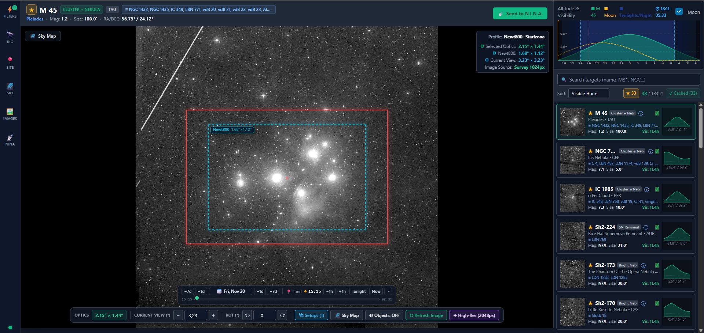
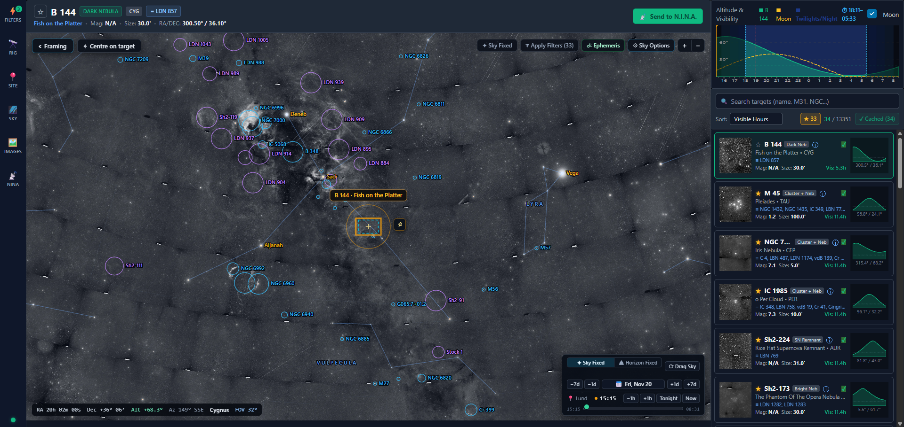

# My Sky Observer

Fast, dark-mode astrophotography target planner, FOV framing assistant, and interactive sky atlas.

[](https://buymeacoffee.com/mxpwr)




> **Core Workflow:** Set your location, equipment, and filters, then click **⬇️ Download Filtered** to pre-cache high-res cutouts for all matching targets — enabling instant, zero-lag browsing (online or in the field).

## Features

- **Target Planning:** Filter thousands of deduplicated catalog DSOs, planets, and comets by altitude, night visibility hours, magnitude, size, type, and favorites.
- **Night & Ephemeris Console:** Inspect altitude curves, moon illumination/separation, twilight bounds, and custom observing dates or time windows.
- **Sensor Framing:** Project primary and comparison telescope/camera FOVs with rotation onto cached high-resolution DSS/SDSS cutouts.
- **60 FPS Sky Map:** Zoom seamlessly from target framing out to an interactive wide-field sky atlas with constellations, horizon rings, and bundled multi-LOD WebP survey tiles.
- **N.I.N.A. Sync:** Push target coordinates and framing rotation directly to N.I.N.A. (native or via Docker).
- **Offline Ready:** Bundled sky atlas plus persistent local cache for pre-downloaded cutouts, settings, and favorites.

## Quick Start

### Windows Binary (Recommended)

Download and run the latest standalone Windows release from **[GitHub Releases](https://github.com/stone17/my_sky_observer/releases)** — no Python, Node.js, or Docker required.

### Docker

```bash
docker-compose up -d --build
```
Open `http://localhost:8000`.

### From Source (Python 3.10+ & Node.js)

**Windows:**
```bat
install.bat
```

**Linux / macOS:**
```bash
./install.sh
uvicorn backend.main:app --reload
```

- **Web UI:** `uvicorn backend.main:app --reload` (`http://127.0.0.1:8000`)
- **Desktop Window:** `python run.py`
- **Dev & Tests:** `cd frontend && npm run dev` · `pytest`

## License

- **Code:** [MIT License](LICENSE)
- **Bundled Sky Atlas (`frontend/public/sky_atlas/`):** [CC BY-NC-SA 4.0](LICENSE-ASSETS.md) — Digitized Sky Survey (STScI / Caltech / UKST / AAO / NASA HEASARC *SkyView*).
